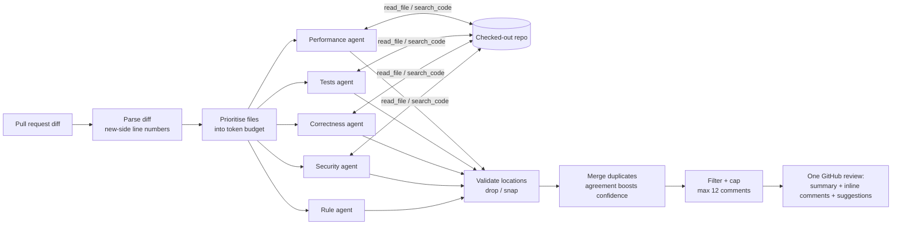

# review-crew

**A team of specialist LLM agents that review pull requests. They post one focused review, with
every comment anchored to a real line in the diff.**

Most "AI code review" bots run one prompt over the diff and post whatever comes back:
hallucinated line numbers, the same issue three times, and twenty nitpicks that get ignored.
review-crew treats review as a coordination problem:

- **Specialists:** separate agents for security, correctness, tests and performance, each with a
  narrow brief, plus a free rule-based scanner.
- **Tools:** agents can `read_file` and `search_code` in the checked-out repo, so they can check
  callers and definitions before claiming a bug.
- **Structured output:** agents answer by calling a `submit_findings` tool with a JSON schema, not
  free text.
- **A coordinator that keeps the noise down:** it drops findings on lines that aren't in the diff,
  merges duplicates across agents (agreement *raises* confidence), filters by confidence and
  severity, and caps the comment count.
- **Measurement:** a seeded-bug evaluation set reports recall, precision and noise on clean PRs.

## How it works



| Piece | File | Notes |
|---|---|---|
| Diff parser | `diff.py` | Tracks hunk line counts, so a removed line starting with `--` isn't read as a header; skips binaries, lockfiles and deletions |
| Agent loop | `agents/llm_agent.py` | Tool-use loop with a per-agent tool budget; a failing agent is contained, not fatal |
| Rule agent | `agents/rules.py` | Regex checks for injection, secrets, unsafe deserialisation, mutable defaults…, added lines only |
| Coordinator | `coordinator.py` | Parallel agents, location validation, de-duplication, filtering, comment cap |
| GitHub | `github.py`, `report.py`, `action.yml` | One `COMMENT` review (never approves or blocks), GitHub suggestion blocks, falls back to summary-only if GitHub rejects an inline comment's position |
| Evaluation | `eval/` | 12 PRs with planted bugs and 3 clean PRs |

## Use it

**As a GitHub Action** in any repo:

```yaml
# .github/workflows/review.yml
on: { pull_request: { types: [opened, synchronize] } }
permissions: { contents: read, pull-requests: write }
jobs:
  review:
    runs-on: ubuntu-latest
    steps:
      - uses: actions/checkout@v4
        with: { ref: "${{ github.event.pull_request.head.sha }}" }
      - uses: shubhiofficial-17/review-crew@main
        with: { anthropic-api-key: "${{ secrets.ANTHROPIC_API_KEY }}" }
```

**From the command line:**

```bash
pip install -e ".[dev]"
git diff main | review-crew diff - --rules-only       # free, no API key
export ANTHROPIC_API_KEY=...
git diff main | review-crew diff -                    # full crew
GITHUB_TOKEN=... review-crew pr owner/repo 42 --post  # review a PR and post it
```

## Evaluation

`python -m eval.run_eval` runs a reviewer configuration over 15 synthetic PRs:

- **12 with one planted bug each.** Six are *pattern* bugs a regex can find (SQL injection,
  `shell=True`, a hardcoded key, a mutable default, `yaml.load`, a bare `except`). Six are
  *reasoning* bugs no regex can find: a delete endpoint missing the ownership check the GET
  endpoint has, an off-by-one in 1-based pagination, a possible `None` dereference, an N+1 query, a
  read-modify-write race on stock, and a naive vs aware datetime comparison.
- **3 clean PRs.** Every comment on these counts as noise.

Rule-agent baseline (no LLM), measured:

| configuration | recall | pattern bugs | reasoning bugs | precision | noise on clean PRs |
|---|---|---|---|---|---|
| rules only | 50% | 100% (6/6) | **0% (0/6)** | 100% | 0 comments |
| rules + 4 LLM agents | *run it* | | | | |

The rules catch every pattern bug with no false alarms, and none of the bugs that need reasoning.
Those six are what the LLM agents are for. To fill in the second row:

```bash
ANTHROPIC_API_KEY=... python -m eval.run_eval --report eval-report.json
```

It also prints token usage and an estimated cost. The price table in `llm.py` holds placeholder
values; set it from your provider's current prices first.

## Design decisions

- **Specialists over one big prompt.** A narrow brief ("you only care about authorisation and
  injection") gets more thorough attention than a prompt asking for everything. Agents run in
  parallel, so this adds no wall-clock time; the cost is more input tokens, which the
  per-agent budget controls.
- **Never trust the model's line numbers.** Agents see the diff with explicit new-side line
  numbers, and every finding is checked against the lines the diff actually contains. Near-misses
  (≤ 3 lines) are moved onto the nearest added line; anything else is dropped and counted.
- **Agreement is a signal.** When independent agents flag the same line, the duplicates are merged
  and the confidence goes up. One agent's speculation stays at its own confidence and may be
  filtered out.
- **A noise budget.** The comment cap (default 12) and the confidence threshold exist because a
  review with 40 comments goes unread. Findings are ranked by severity, then confidence.
- **Structured output via a tool.** `submit_findings` has a JSON schema, so output is
  schema-shaped. A fallback still pulls JSON out of a text reply, and malformed items are dropped
  one by one rather than failing the review.
- **Deterministic tests for a non-deterministic system.** `ScriptedClient` replays model responses,
  so the tool loop, budgets, error containment and coordinator logic are all unit-tested offline.

## Limitations

- The evaluation set is small and synthetic. It shows the method works; it isn't a benchmark. More
  realistic cases would be bugs from real commits with their fixes as ground truth.
- Duplicate merging is heuristic (same line plus a shared word, or the same category within 2
  lines). Two distinct bugs on adjacent lines in the same category can get merged.
- Tools are read-only and limited to the checked-out head commit; agents can't run tests.
- Python-centric rules; the LLM agents are language-agnostic.

## License

MIT
